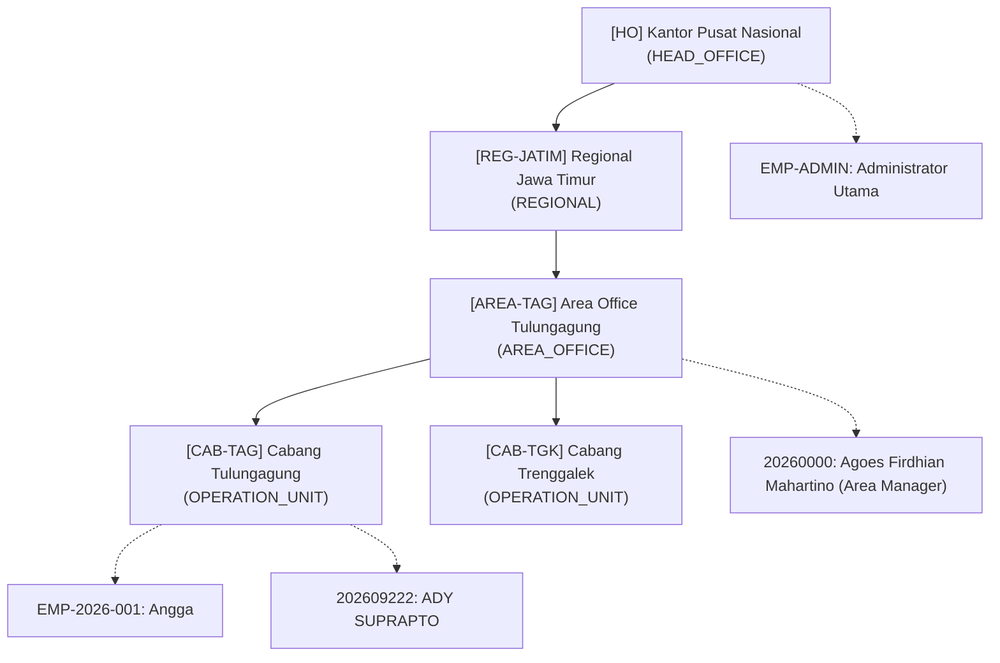

# Panduan & Dokumentasi: Teritori Management & Data Export Operation Unit / Karyawan

Dokumen ini merangkum riwayat pengerjaan, perbaikan kendala teknis, serta panduan data import untuk modul **Teritori Management (District)** dan **Hierarchical Operation Unit & Karyawan**.

---

## 📌 1. Riwayat & Analisis Masalah Sebelumnya

Sebelumnya pengerjaan Teritori Management terhenti akibat model API overload dengan kondisi antarmuka seperti pada screenshot:
1. **Dropdown Operation Unit Kosong (`-- Pilih Operation Unit --`)**:
   - Di `hsera-auth-backend`, endpoint `GET /api/operation-units` mengembalikan array murni `[ { id, code, name, ... } ]` dengan properti `code` dan `name`.
   - Di `hsera-salesmanship-backend` (`AuthBackendServiceClient.ts`), parser memeriksa `if (res.data && res.data.data)` dan mencari properti `u.kode` serta `u.nama`. Akibatnya hasil parsing selalu menghasilkan array kosong `[]`.
2. **Salesman Lapangan Hanya Menampilkan NIK Tanpa Nama**:
   - Master Karyawan menyimpan nama lengkap di kolom `legal_name` (`legalName`).
   - Service client mencari `k.namaLengkap || k.nama || k.name`, sehingga nama terisi string kosong `""` dan dropdown hanya merender `(NIK: 0000000000000000)`.
3. **Kebutuhan Data Scoping Berdasarkan Role Management**:
   - Pengguna meminta agar Operation Unit yang muncul di dropdown disesuaikan dengan posisi unit karyawan login:
     - **Super Admin (HO)**: Dapat melihat seluruh unit nasional.
     - **Regional Manager**: Hanya dapat melihat unit regional beserta seluruh Area Office dan Cabang di bawahnya.
     - **Area Manager** (misal *Area Manager Tulungagung*): Hanya dapat memilih Area Office dan Cabang yang menginduk ke area tersebut (*Cabang Tulungagung*, *Cabang Trenggalek*).
4. **Desain Form Samping (Drawer / SlideOver)**:
   - Sesuai arahan sebelumnya, form input teritori menggunakan slide drawer dari sisi samping (seperti *Master Karyawan*) agar konsisten dengan antarmuka platform.

---

## 🛠️ 2. Solusi & Perubahan yang Telah Diterapkan

### A. Auth Backend (`hsera-auth-backend` & `auth-platform-backend`)
1. **Repository & Use Case**:
   - Menambahkan `allowedUnitIds?: string[]` pada `IOperationUnitRepository.findAll()`.
   - Menambahkan fungsi `getUnitIdsCreatedBy(userId)` untuk mencakup unit yang dibuat langsung oleh user.
   - Menambahkan method `getScopedUnits()` di `ManageOperationUnitUseCase` yang secara otomatis mengevaluasi hirarki pohon rekursif (`getAllDescendantIds`) dan melampirkan breadcrumb lineage.
2. **Endpoint Baru**:
   - `GET /api/operation-units/my-scope`: Endpoint khusus untuk mengambil daftar Operation Unit sesuai hirarki login pengguna (cukup memerlukan autentikasi Bearer token, tanpa terhalang ACL menu CRUD master Operation Unit).
   - Mendukung filter `?onlyBranches=true` untuk mengambil unit level operasional (`OPERATION_UNIT`) saja.
   - `GET /api/karyawan/lookup`: Endpoint referensi karyawan yang otomatis memfilter personil di bawah unit yang diizinkan untuk user tersebut.

### B. Salesmanship Service (`hsera-salesmanship-backend`)
1. **`AuthBackendServiceClient.ts`**:
   - Memperbaiki parser `getOperationUnits` agar memanggil `/api/operation-units/my-scope` dan memetakan `u.code -> kode`, `u.name -> nama`, `u.category -> kategori`.
   - Memperbaiki parser `getKaryawanList` agar memanggil `/api/karyawan/lookup` dan memetakan `k.legalName -> namaLengkap`, `k.nik`, serta `k.operationUnitId`.
2. **`DistrictController.ts`**:
   - Memperbaiki data scoping non-superadmin: Resolusi unit IDs (UUID) kini dipetakan ke kode wilayah (`filter.ouKodeIn = allowedOus.map(u => u.kode)`), sehingga pencarian teritori di database mencocokkan kolom `ou_kode` dengan benar.
   - Memperbaiki resolusi nama salesman (`karyawanName`) pada tabel teritori.

### C. Dashboard Frontend (`hsera-dashboard`)
1. **`TerritoryModal.tsx` (`TerritoryFormDrawer`)**:
   - Menggunakan komponen `SlideOver` (drawer samping) berdesain clean & responsif.
   - Menampilkan jumlah unit wilayah yang tersedia sesuai izin akses.
   - Pilihan Operation Unit menampilkan format: `[CAB-TAG] Cabang Tulungagung • Cabang`.
   - Dropdown Salesman Lapangan secara dinamis menyaring salesman yang bertugas di Operation Unit yang sedang dipilih, lengkap dengan badge filter dan NIK.
2. **`useTerritory.ts`**:
   - Saat modal tambah dibuka, default unit otomatis terisi dengan unit operasional pertama yang diizinkan dan salesman yang relevan.

---

## 📦 3. File Data Export untuk Project Baru (PostgreSQL)

Seluruh file data telah ditaruh di folder `doc/` baik pada repositori ini maupun di project baru (`hsera/hsera-auth-backend/doc/`):

| Nama File | Format | Deskripsi |
|---|---|---|
| [export_operation_unit_karyawan.sql](file:///Users/dyra/Documents/Docker/framework-app/auth-platform-backend/doc/export_operation_unit_karyawan.sql) | SQL Script | Script import data PostgreSQL idempotent (`BEGIN; ... COMMIT;`), otomatis menonaktifkan trigger circular foreign key sementara (`SET session_replication_role = 'replica';`), memasukkan 5 Operation Unit berhirarki, 2 Karyawan, dan menghubungkan user account. |
| [operation_unit_karyawan.json](file:///Users/dyra/Documents/Docker/framework-app/auth-platform-backend/doc/operation_unit_karyawan.json) | JSON | Data lengkap 5 Operation Unit dan Karyawan dalam format JSON untuk script custom atau seed Prisma. |
| [operation_unit.csv](file:///Users/dyra/Documents/Docker/framework-app/auth-platform-backend/doc/operation_unit.csv) | CSV | File CSV master Operation Unit (Head Office, Regional, Area, Cabang). |
| [karyawan.csv](file:///Users/dyra/Documents/Docker/framework-app/auth-platform-backend/doc/karyawan.csv) | CSV | File CSV master Karyawan. |

### Lokasi di Proyek Baru (`hsera`):
- `/Users/dyra/Documents/Docker/hsera/hsera-auth-backend/doc/export_operation_unit_karyawan.sql`
- `/Users/dyra/Documents/Docker/hsera/hsera-auth-backend/doc/operation_unit_karyawan.json`
- `/Users/dyra/Documents/Docker/hsera/hsera-auth-backend/doc/operation_unit.csv`
- `/Users/dyra/Documents/Docker/hsera/hsera-auth-backend/doc/karyawan.csv`

---

## 🚀 4. Cara Menjalankan Import ke PostgreSQL

### Menggunakan Perintah Docker CLI:
```bash
docker exec -i hsera_postgres psql -U postgres -d hsera < /Users/dyra/Documents/Docker/hsera/hsera-auth-backend/doc/export_operation_unit_karyawan.sql
```

### Menggunakan psql langsung:
```bash
psql -h localhost -p 5433 -U postgres -d hsera -f /Users/dyra/Documents/Docker/hsera/hsera-auth-backend/doc/export_operation_unit_karyawan.sql
```

---

## 🌳 5. Ringkasan Pohon Struktur Data yang Dimuat


